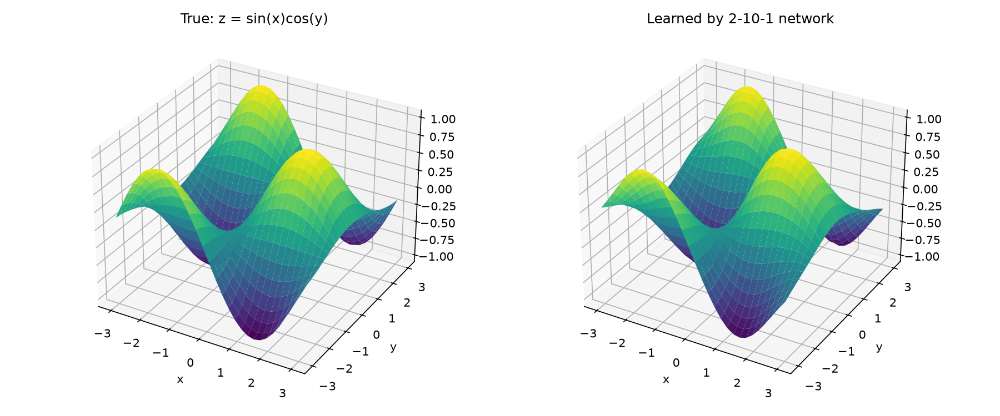
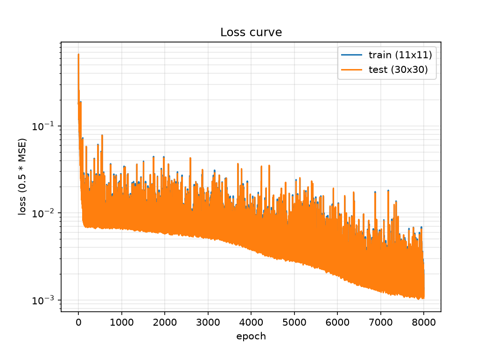

# mini-nn

A small neural-network library written from scratch with NumPy, to understand how back-propagation really works.
It started as a port of my MATLAB neural-network code to Python.

## What it does

- `Layer`: one fully connected layer with sigmoid or linear activation. The bias is stored as the last column of the weight matrix. It has `forward`, `backward` and `update`.
- `Network`: a list of layers trained with mini-batch gradient descent and a mean squared error loss. It records the training and validation loss after every epoch.
- No machine-learning frameworks: the forward pass, the gradients and the weight updates are all written by hand.

## Example: learning z = sin(x)·cos(y)

`train_surface.py` trains a 2-10-1 network (10 sigmoid neurons, 1 linear output) on an 11×11 grid of points and tests it on a 30×30 grid it never sees during training.

| | MSE |
|---|---|
| Training set (121 points) | 0.0024 |
| Test set (900 points) | 0.0021 |

## Run it

You need Python 3 with NumPy and Matplotlib.

    pip install numpy matplotlib
    python train_surface.py

It saves `surface_comparison.png` and `loss_curve.png`. The seed is fixed, so every run gives the same result.

## Files

| File | What it contains |
|---|---|
| `layer.py` | The `Layer` class |
| `network.py` | The `Network` class and the training loop |
| `data.py` | The training and test grids for z = sin(x)·cos(y) |
| `train_surface.py` | Trains the network and saves the plots |
| `hello.py` | My first NumPy test |

## Next steps

- More activation functions (tanh, ReLU)
- A classification example with cross-entropy loss
- Unit tests that check the gradients numerically
